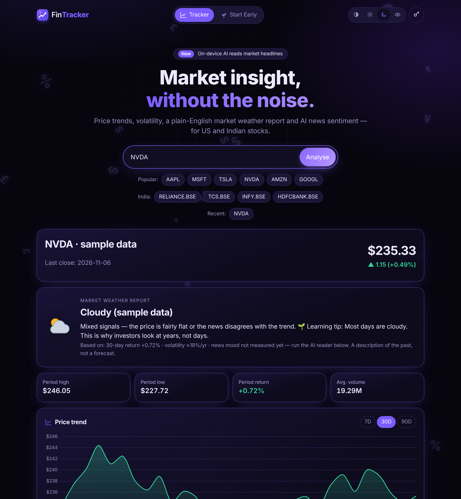
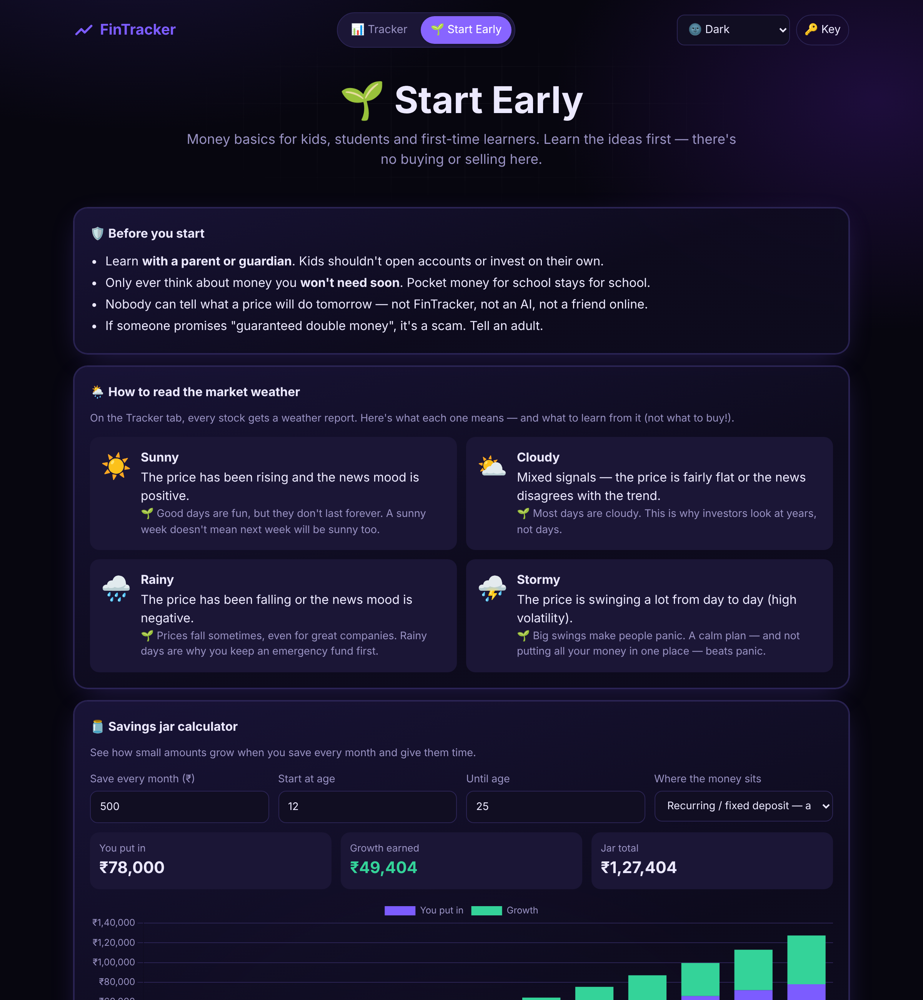

# 📈 FinTracker

**FinTracker** shows a stock's price trend, a volatility score and the sentiment of recent news, all on one screen.
It was built for the **Call2Code Hackathon** and includes **text-to-speech** so that news can be listened to.

🔗 **Live demo:** https://fintracker-demo.netlify.app/





---

## ✨ Features

| Feature | How it works |
|---|---|
| ✨ **Splash screen** | The FinTracker wordmark arrives as 5 slices from different 3D depths (CSS 3D transforms) and joins together. About 2 seconds, skippable, once per visit, skipped for "reduce motion" |
| 🌦️ **Market weather report** | Turns trend, volatility and news mood into ☀️ Sunny, ⛅ Cloudy, 🌧️ Rainy or ⛈️ Stormy, with a plain-English explanation and a learning tip |
| 🤖 **AI headline reader** | A DistilRoBERTa transformer fine-tuned on financial news runs **in the browser** with Transformers.js (ONNX + WebAssembly). It labels each headline positive, neutral or negative and averages them into the news mood. No server, and no data leaves the device |
| 🌱 **Start Early tab** | For kids and first-time learners, with original animated characters (Penny the Piggy Bank, Captain Coin and Jarvis the Jar): money rules on a chalkboard, a guide to the weather report, a ₹ savings jar calculator showing compounding, a 5-question quiz and a word bank |
| 📊 **Price trend (7D / 30D / 90D)** | Daily prices from Alpha Vantage, drawn with Chart.js. Shows period high, low, return and average volume |
| ⚡ **Volatility score** | Standard deviation of daily returns, annualised (× √252). Labelled Low / Moderate / High |
| 📰 **Latest news** | Recent headlines about the company from [Hacker News search](https://hn.algolia.com/api), with the [GDELT](https://www.gdeltproject.org/) news database as a backup. Neither needs a key |
| 🎤 **Listen to news** | The Web Speech API reads each headline and summary aloud |
| 🔎 **Any stock, US or Indian** | Search any symbol. Indian stocks use `.BSE` (e.g. `RELIANCE.BSE`) and show prices in ₹. One-click chips for popular US and Indian stocks, plus recent searches |
| 🌓 **4 colour modes** | Auto (light by day, dark by night), light, dark and eye comfort, each with its own animated background: glowing currency signs (dark), mini charts (light), falling ₹ coins (eye comfort) and a sun or moon crossing the sky (auto). Animations switch off for people who turn on "reduce motion" |
| 🌐 **Multilingual** | Google Translate widget |
| 🧪 **Sample-data fallback** | If the free API limit is reached, the app shows clearly labelled sample data instead of breaking |

## 🔑 API key

The first time someone searches, FinTracker asks:

1. **"Do you have your own Alpha Vantage key?"** If yes, it's saved only in that visitor's browser.
2. **If not**, it uses the shared demo key in `config.js`.

> Free Alpha Vantage keys allow about 25 requests a day. Each search uses 1 request (news sources need no key).
> Get a free key at https://www.alphavantage.co/support/#api-key

## 🧠 Tech stack

- HTML, CSS (theme variables), vanilla JavaScript
- [Chart.js](https://www.chartjs.org/) for charts
- [Alpha Vantage](https://www.alphavantage.co/) for daily prices
- [Hacker News search API](https://hn.algolia.com/api) and [GDELT](https://www.gdeltproject.org/) for recent news headlines
- [Transformers.js](https://huggingface.co/docs/transformers.js) for in-browser AI (model: `mrm8488/distilroberta-finetuned-financial-news-sentiment-analysis`, ONNX version)
- [Web Speech API](https://developer.mozilla.org/en-US/docs/Web/API/Web_Speech_API) for text-to-speech

## 📁 Project structure

```
index.html   page layout and API-key dialog
style.css    themes and responsive layout
config.js    default (demo) API key
script.js    data fetching, calculations, weather report, chart, news, speech
ai.js        in-browser AI sentiment model (Transformers.js)
decor.js     icons, weather icons, floating background per colour mode
icon.svg     app logo / favicon
learn.js     Start Early tab: calculator, quiz, word bank
screenshots/ README images
```

## 🛠️ Run locally

Download the repo (Code → Download ZIP), unzip it and open `index.html` in a browser.
No build step is needed.

---

*For learning purposes only. This is not financial advice.*
